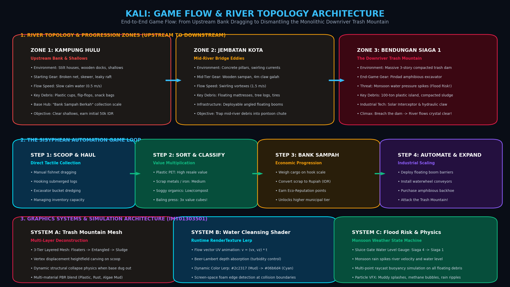

# ARCHITECTURE.md — Unity URP + Blender System Design & Contracts

> **Purpose**: Defines the conflict-free folder hierarchy, `RiverMath` coordinate mapping (`130m × 180m`), C#-to-Shader/Collider contracts, and the `SK_ExcavatorAmfibi` IK + hydraulic piston rigging spec shared across **Ivan**, **JC**, **Wesley**, and **Niki**.



---

## 1. Repository Directory Structure (Conflict-Free Ownership)

```text
kali-river-sweeper/
├── AGENTS.md                                # [Ivan] Master AI rules, directory boundaries & guardrails
├── CLAUDE.md                                # [Ivan] Quick AI entry pointer
├── README.md                                # [Shared] Overview, team split & quick start
├── plan_ivan.md                             # [Ivan] Isolated implementation plan (Core C#, Map, Report)
├── plan_jc.md                               # [JC] Isolated implementation plan (Props, Tools, IK Rig, Lighting)
├── plan_wesley.md                           # [Wesley] Isolated implementation plan (10 Env Meshes, Shaders)
├── plan_niki.md                             # [Niki] Isolated implementation plan (VFX, UI Canvases, Audio)
├── docs/
│   ├── PLAYBOOK.md                          # Master AI-assisted production playbook & rubric scorecard
│   ├── PRD.md                               # Product Requirements, 20 tools, Medical Waste, 3 endings
│   ├── ARCHITECTURE.md                      # System design, C# contracts & rigging architecture (this file)
│   ├── DESIGN.md                            # Visual identity, color palette, PBR rules & HUD typography
│   ├── TECH_STACK.md                        # Unity 2022.3.46f1 URP, Blender 5.3.0 & poly budgets
│   ├── TEAM_WORKFLOW.md                     # Integration sequence, Git rules & ready-to-paste prompts
│   └── KALI_Asset_Master_Tracker.xlsx/.tsv  # 55-row complete asset deliverable tracker
├── tools/
│   ├── play-3d.html                         # [Ivan] Standalone Three.js browser prototype (zero Unity needed)
│   └── map-editor.html                      # [Ivan] Interactive 51-node river level layout editor
└── unity/
    ├── ProjectSettings/ProjectVersion.txt   # Unity 2022.3.46f1
    ├── Packages/manifest.json               # URP 14.0.11, ShaderGraph, VFX Graph, AnimationRigging
    └── Assets/_Project/
        ├── Scripts/                         # [Ivan ONLY] Core/, Player/, Editor/
        ├── Data/kali-river-map.json         # [Ivan ONLY] 51 spatial river nodes & landmarks
        ├── Props/                           # [JC ONLY] Trash/, Equipment/ (20 tools, vessels, booms)
        ├── Rigging/                         # [JC ONLY] SK_ExcavatorAmfibi.fbx & Animator controllers
        ├── Lighting/                        # [JC ONLY] KaliLightingBuilder.cs, PF_LightingRig, Profiles
        ├── Environment/                     # [Wesley ONLY] Meshes/, Materials/, Textures/, Prefabs/ (10 SM_Env_*)
        ├── Shaders/                         # [Wesley ONLY] SG_KaliWater.shadergraph, SG_TrashTriplanar
        ├── VFX/                             # [Niki ONLY] 4 URP VFX / Shuriken particle prefabs
        ├── UI/                              # [Niki ONLY] Canvas_HUD, Canvas_ShopBankSampah, Canvas_SDGImpactReport
        ├── Audio/                           # [Niki ONLY] Ambience, splash, siren & UI SFX
        └── Scenes/                          # [Ivan Integration] Generated via KALI > Load Default Purpose-Built Map
```

---

## 2. Single Source of Truth Constants & Coordinate Contract (`RiverMath`)

Defined in `unity/Assets/_Project/Scripts/Core/RiverFlowBuoyancy.cs` and mirrored in `tools/play-3d.html`:

| Constant / Method | Exact Value / Formula | Impact Across Team |
| :--- | :--- | :--- |
| `WorldW` / `WorldH` / `MapScale` | `1040f` / `1440f` / `0.125f` | **Wesley's Terrain Footprint** MUST equal **`130m (X) × 180m (Z)`**, centered at `(0, 0, 0)`. |
| `ToWorld3D(mapX, mapY, elev)` | `((mapX - 520) * 0.125, elev, (mapY - 720) * 0.125)` | Converts `kali-river-map.json` nodes into Unity meters. |
| `RiverCenterMapX(mapY)` | `520 + sin((mapY / 1440) * PI * 1.6) * 58` | Exact S-curve centerline Wesley's `SM_Env_RiverValleyTerrain` riverbed must follow. |
| `RiverHalfWidthMap(mapY)` | Base width `22.5m`, narrows at `mapY = 740` (Bridge), widens at `mapY < 320` & `mapY = 1220` | Houses/warungs (`+0.8m` elev) must stay clear of channel banks (`IsInRiver()`). |
| Current Vector & Water Y | `waterLevelY = 0.0f`, drift toward **`-Z`** (`pos.z > -44f`) | Floating trash (`JC`), water flow UV pan (`Wesley`), and foam (`Wesley`/`Niki`) align on **`-Z`**. |

---

## 3. C# Runtime Hooks & Integration Contracts

All subsystems integrate via these verified symbols in `Scripts/`:

### A. Shader Global Contract (`RiverGameManager.cs` $\leftrightarrow$ `Wesley`)
- `RiverGameManager.NotifyState()` executes **`Shader.SetGlobalFloat("_WaterClarity", waterClarity)`** (`0.12f` polluted muddy brown $\rightarrow$ `1.0f` crystal turquoise).
- `SG_KaliWater.shadergraph` MUST define a Blackboard Float property with exact Reference Name **`_WaterClarity`**.
- Water surface panning: dual normal maps scrolled in **`-V`** (`-Z` world flow); depth absorption via `Scene Depth - Screen Position (W)`; shoreline/trash foam via `Step(0.35, DepthDiff)`.

### B. Collider & Name Hooks (`KaliPlayerController.cs` $\leftrightarrow$ `Wesley` & `JC`)
- `TryInteractWithNearbyHub()` scans `Physics.OverlapSphere(pos, 6f)` on **`E`** press:
  - GameObject containing **`"Bank Sampah"`** with Collider $\rightarrow$ calls `SellAtBankSampah(false)`.
  - GameObject containing **`"Pos Sortir"`** with Collider $\rightarrow$ calls `SellAtBankSampah(true)`.
- `TryScoopOrDredge()` scans forward sphere on **`Left Click`**:
  - GameObject with **`RiverFlowBuoyancy`** + Collider $\rightarrow$ scoops floating trash (`TryAddCargo(1)`).
  - GameObject containing **`"Gunung Sampah"`** with Collider + `excavatorUnlocked` $\rightarrow$ calls `DamageGunungSampah(0.20f)` and scales/breaches mound.

### C. Prefab Auto-Spawner Hooks (`MapJsonImporter.cs` $\leftrightarrow$ `JC` & `Wesley`)
Menu item **`KALI > Load Default Purpose-Built Map`** parses all **51 nodes** in `kali-river-map.json` (`11` rumah, `7` warung, `11` pohon, `8` trash_pile, `3` gunung_node, `2` dermaga, `1` sluice_gate, `1` jembatan, `1` bank_sampah, `1` toko_alat, `1` sorting_yard, `1` trash_boom, `1` excavator, `1` interceptor, `1` spawn) and auto-loads exact paths:
- `Assets/_Project/Lighting/Prefabs/PF_LightingRig.prefab`
- `Assets/_Project/Lighting/Prefabs/PF_Lantern_Warung.prefab` (attached above `warung` nodes)
- `Assets/_Project/Lighting/Prefabs/PF_WarningBeacon_PintuAir.prefab` (attached atop `sluice_gate`)
- `Assets/_Project/Props/Equipment/Prefabs/PF_Prop_TrashBoomSegment.prefab`
- `Assets/_Project/Props/Trash/Prefabs/PF_Trash_{SandalSwallow,AquaBottle_600ml,AquaGalon_19L,PopMieCup,KresekBag,KasurKapuk,BanBekas,EcengGondok,BatangPisang}.prefab`

### D. Event Subscriptions for UI & VFX (`RiverGameManager.cs` $\leftrightarrow$ `Niki`)
- `RiverGameManager.Instance.OnStateChanged` $\rightarrow$ Refresh `Canvas_HUD` (`rupiah`, `cargoCount/cargoCapacity`, `SiagaLevel`, `floodPressure`, `waterClarity`, `gunungSampahHealth`, `communityTrust`, `medicalWasteSecured`, `infectionIncidents`).
- `RiverGameManager.Instance.OnWeatherChanged(bool isMonsoonStorm)` $\rightarrow$ Toggle `VFX_MonsoonRain` and storm lighting/audio.
- `RiverGameManager.Instance.OnEndingTriggered(GameEnding ending)` $\rightarrow$ Display `Canvas_SDGImpactReport` with `recycledKg`, `flushedKg`, `medicalWasteSecured`, `communityTrust`, and verdict for **SDG 6.3 / 11.5 / 14.1**.

---

## 4. Hero IK & Hydraulic Rigging Spec (`SK_ExcavatorAmfibi` — `JC`)

1. **Bone Hierarchy**:
   - `B_Root_Hull` (Pontoon hull + `B_Spud_Leg_FL/FR/BL/BR` lowering `-3.5m` in Z)
   - $\rightarrow$ `B_Turret_Slew` (360° Z rotation) $\rightarrow$ `B_Arm_Boom` (`4.2m`) $\rightarrow$ `B_Arm_Stick` (`2.8m`) $\rightarrow$ `B_Tool_Bucket` (`1.4m` dredge scoop + clamp)
   - Controllers (Deform UNCHECKED): `CTRL_IK_Bucket`, `POLE_Elbow_Target`.
2. **IK Solver**: Pose Mode on `B_Arm_Stick` $\rightarrow$ `Inverse Kinematics` constraint $\rightarrow$ Target `CTRL_IK_Bucket`, Pole `POLE_Elbow_Target`, **`Chain Length = 2`** (Boom + Stick only).
3. **Zero-Clipping Hydraulic Pistons**: Mutual **`Damped Track` (`+Y`)** pair (`Cylinder` parented to Turret tracking `Ram`; `Ram` parented to Boom tracking `Cylinder`) so chrome rods telescope smoothly with zero keyframing.
4. **FBX Export Protocol (Blender 5.3 $\to$ Unity 2022.3)**:
   - `Ctrl + A -> All Transforms` (`Scale: 1.0`, `Rot: 0,0,0`).
   - Forward: `-Z Forward`, Up: `Y Up`.
   - Armature tab: **UNCHECK `Add Leaf Bones`**.
   - Unity Inspector Rig tab: Animation Type **`Generic`**, Root Node **`B_Root_Hull`**.
