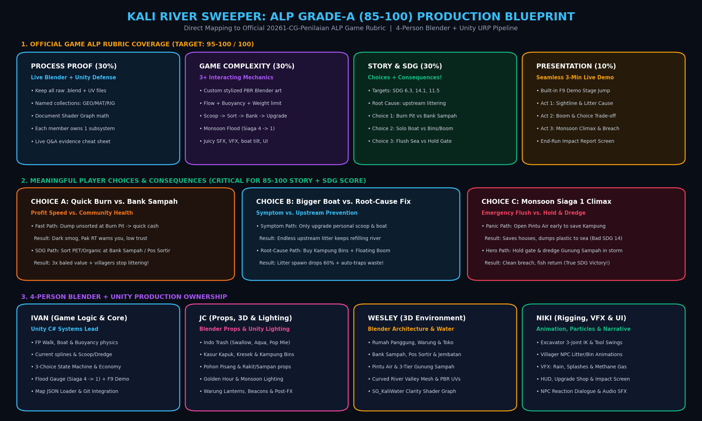

# KALI: Indonesian River Sweeper — AI-Assisted Production Playbook

Official development playbook for **KALI: Indonesian River Sweeper (*Penjaga Terakhir Sungai*)** — **IMT01303501 Computer Graphics Final Project (ALP)** at Universitas Ciputra Surabaya (Game Track, audited against `20261-CG-Penilaian ALP.pdf` for **85–100 / Grade A**).

---

## 1. Complete Documentation Suite

| Document | Purpose | Target Audience |
| :--- | :--- | :--- |
| **[README.md](../README.md)** | Repository overview, narrative hook, team roster, quick start, and member plans. | All Contributors |
| **[AGENTS.md](../AGENTS.md) / [CLAUDE.md](../CLAUDE.md)** | Master AI instructions, strict `Assets/_Project/` folder isolation, C# contracts, and rubric guardrails. | AI Agents (Claude Code, Antigravity, Cursor, ChatGPT) |
| **[docs/PRD.md](./PRD.md)** | Product Requirements Document: 20 Kopdes tools (`BuyTool`), vessel progression, surface swimming/stamina/drowning, 3 waste classes & 3 stations vs `Gudang Pengepul`, linear flood/Sell-Lock, 3 Choices, 5 Endings, and SDG targets. | All Contributors |
| **[docs/ARCHITECTURE.md](./ARCHITECTURE.md)** | Unity URP + Blender system architecture, conflict-free directory layout, `RiverMath` (`130m × 180m`), C# hooks (`_WaterClarity`), and Excavator IK rig spec. | Ivan, JC, Wesley, Niki |
| **[docs/DESIGN.md](./DESIGN.md)** | "Kalimas Nusantara" art direction, pollution-to-clean palette, `Siaga 4 -> 1` alert colors, PBR surface specs, and UI typography. | JC, Wesley, Niki |
| **[docs/TECH_STACK.md](./TECH_STACK.md)** | Software versions (`Unity 2022.3.46f1`, `Blender 5.3.0`, `URP 14.0.11`), packages, and poly/draw-call budgets. | All Contributors |
| **[docs/TEAM_WORKFLOW.md](./TEAM_WORKFLOW.md)** | Sprint tracks, parallel build sequence, branch/folder workflow, and ready-to-paste onboarding prompts per member. | Ivan, JC, Wesley, Niki |

---

## 2. Team Directory & Isolated Scopes

| Member | Role | Student ID | Primary Track & Unity Folders |
| :--- | :--- | :--- | :--- |
| **Stevanus Ivan Santoso** (`Ivan`) | **Coordinator & Core Lead** | `0706012410029` | Architecture, docs, contracts lock, C# gameplay/buoyancy/economy (`RiverGameManager`, `ToolCatalog`, `RiverTrashSpawner`), 53-node `kali-river-map.json`, `MapJsonImporter`, `tools/play-3d.html` (`Scripts/`, `Data/`, `tools/`) |
| **Jason Christopher** (`JC`) | **Props, Rigging & Lighting Lead** | — | Trash (`Normal`, `MedicalBag`, `SyringeBox`, `Biohazard`) props, 20 tool models (`PF_Tool_*` `isTrigger=true`/disabled while equipped), vessels, `SK_ExcavatorAmfibi` IK arm, `PF_LightingRig` + `+Z` `Pintu Air` beacon (`Props/`, `Rigging/`, `Lighting/`) |
| **Wesley Goeinawan** (`Wesley`) | **Environment & Water Shader Lead** | `0706012410011` | Custom Blender architectural FBX meshes (`+Z` `Pintu Air`, `Pos Medis B3`, `Karantina Biohazard`, `Gudang Pengepul` near Spawn) synced to `RiverMath` `130m × 180m` spline, `SG_KaliWater` (`_WaterClarity`, `+V` flow), `SG_TrashTriplanar` (`Environment/`, `Shaders/`) |
| **Nicholas Gerwin Mawardji** (`Niki`) | **VFX, UI & Audio/Narrative Lead** | `0706012410015` | 4 particle emitters (`MonsoonRain`, `WaterSplashMuddy`, `MethaneSludgeBubbles`, `TrashAvalanche`), HUD (`playerHealth`, `swimStamina`, 3-class cargo, DoT/Sell-Lock/`Q` dump, Monsoon timer, Kopdes milestone toast)/Shop/SDG Canvases (`5` endings), audio cues, Sidang demo flow (`VFX/`, `UI/`, `Audio/`) |

---

## 3. Official Game ALP Rubric Checklist (Target: 95–100 / 100)

Mapped directly against `20261-CG-Penilaian ALP.pdf` (**GAME** track):

| Rubric Criterion | Weight | 85–100 Benchmark | KALI Deliverable & Sidang Defense Proof |
| :--- | :---: | :--- | :--- |
| **Understanding of the Process** | **30%** | Detailed explanations + live project evidence | Every contributor retains raw `.blend`, UV layouts, Shader Graph nodes, VFX/UI prefabs, and modular C# scripts in Git and explains them live during Q&A. |
| **Complexity: 3D Geometry & Materials** | **30%** *(part)* | Complex, well-crafted custom models + consistent visual style | 52+ custom Blender PBR assets in [KALI_Asset_Master_Tracker.xlsx](./KALI_Asset_Master_Tracker.xlsx): 20 tools, Indonesian kampung buildings, boats, and rigged `SK_ExcavatorAmfibi`. |
| **Complexity: Game Mechanics** | **30%** *(part)* | 3+ interacting mechanics | **6 interacting systems**: (1) `+Z` `RiverMath` current & linear water rise (`Overflow -> Sell-Lock -> FloodFail`), (2) 20 Kopdes-purchased JC tools (`#01..#20`, `BuyTool`) & 3-class waste hazards (`Medical` prick mitigated by `#10 Capitan Ular`, `Biohazard` DoT), (3) 3 dedicated sorting stations (`Bank Sampah`, `Pos Medis B3`, `Karantina Biohazard`) + fines vs `Gudang Pengepul`, (4) Surface-only swimming, swim stamina & drowning (making `Dermaga` boat port & vessels strategic), (5) Monsoon `Siaga 4 -> 1` + 5-min countdown + `Q` anti-deadlock dump, (6) Upstream Kampung Bins + Trash Boom automation. |
| **Complexity: Design & Feedback** | **30%** *(part)* | Meaningful choices + responsive feedback | 3 systemic trade-off choices, dynamic water clarity lerp (`_WaterClarity`), lighting shift, storm rain/splashes, beacons, DoT/drowning/Sell-Lock alerts, `[H]` guide overlay, audio cues, and HUD feedback. |
| **Story & SDG Matchness** | **30%** *(20+10)* | Original narrative seamlessly tied to gameplay + concrete SDG targets | Rooted in Indonesian riverkeepers (*Pandawara / Pasukan Oranye*). Deep cause-effect-solution arc targeting **SDG 6.3**, **SDG 11.5**, and **SDG 14.1** across **5 Endings** (`TrueSdgVictory`, `PartialSurvival`, `CompromisedOceanFlush`, `FloodFail`, `HealthFail`) + **End-Run SDG Impact Report**. |
| **Quality of Presentation** | **10%** | Engaging, seamless execution with clear sequence | Demo: play normally; press `T` to cycle time of day (golden hour, dusk, night, dawn, noon) to showcase the scene states cleanly in 3 minutes. |

---

## 4. Core Architectural Pillars

1. **Prefab-First Parallel Pipeline**: All art, shader, VFX, and UI deliverables are packaged inside member-owned prefabs inside `unity/Assets/_Project/<Domain>/`. Nobody needs to fight over a single shared `.unity` scene file during parallel sprints.
2. **Contract-Driven C# Hooks**: `RiverGameManager`, `RiverFlowBuoyancy`, `KaliPlayerController`, and `MapJsonImporter` expose clean integration points (`_WaterClarity`, `OnStateChanged`, `OnWeatherChanged`, `OnToolUnlocked`, `OnHazardOrAlert`, `OnNearbyDermagaChanged`, `"Bank Sampah"`, `"Pos Medis B3"`, `"Karantina Biohazard"`, `"Gudang Pengepul"`, `"Koperasi Desa"` / `"Kopdes"`, `"Dermaga"`, `"Gunung Sampah"`) so art assets light up gameplay on drop-in.
3. **Browser-First Prototyping (`tools/`)**: Anyone on the team can explore the spatial layout and 3D flood concept immediately in Safari via `tools/play-3d.html` and `tools/map-editor.html` even without opening Unity.
