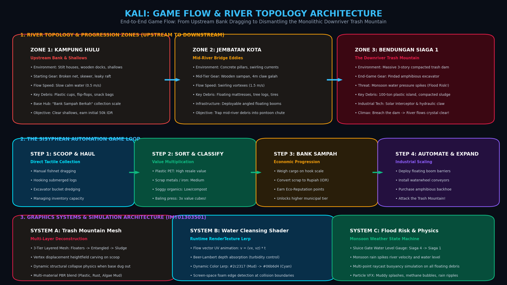

# Product Requirements Document (PRD) — KALI: Indonesian River Sweeper

| Field | Detail |
| :--- | :--- |
| **Project Title** | **KALI: Indonesian River Sweeper** (*Penjaga Terakhir Sungai Nusantara*) |
| **Course & Rubric** | IMT01303501 Computer Graphics (Universitas Ciputra Surabaya) — `20261-CG-Penilaian ALP.pdf` (**GAME** track, target **85–100% Grade A**) |
| **Engine / Art Pipeline** | Unity `2022.3.46f1` LTS (URP `14.0.11`) + Blender `5.3.0` |
| **Coordinator / Lead** | **Stevanus Ivan Santoso** (`0706012410029`) — Core C# Logic, Physics, Map Spawner, Contracts |
| **Team Authors** | **Jason Christopher (JC)** (Props, Rigging & Lighting), **Wesley Goeinawan** (Environment & Water Shaders), **Nicholas Gerwin Mawardji (Niki)** (VFX, UI & Audio/Narrative) |



---

## 1. Story Premise & UN SDG Vision

> *"Di dunia ini, gunung sampah telah menumpuk sangat tinggi hingga mencekik satu-satunya sungai di desa, dan kamu adalah generasi terakhir penjaga sungai yang tersisa."*

* **English Summary**: In this world, mountains of trash have completely choked the village's only river, and you are the last riverkeeper left to save it. Navigate dynamic currents to scoop, sort, and sell waste at the recycling dock, upgrading your gear from plastic dippers and bamboo nets to motorized vacuum pumps and automated river booms. You win by completely dismantling the colossal trash dam and lowering the water level back to safety before the monsoon arrives. You lose if the debris causes the river to breach the levee, drowning the entire village in a catastrophic flood.
* **SDG Targets Integrated Into Mechanics**:
  * **SDG 6.3 (Clean Water & Sanitation)**: Driving `_WaterClarity` from polluted toxic brown (`0.12`) to healthy river turquoise (`1.00`) and eliminating hazardous medical/chemical dumping.
  * **SDG 11.5 (Sustainable Cities / Flood Mitigation)**: Controlling the `Siaga 4 -> 1` flood gauge by clearing sluice chokepoints before monsoon storms flood Kampung Hulu.
  * **SDG 14.1 (Life Below Water)**: Choosing to dredge `Gunung Sampah` responsibly instead of dumping municipal trash into the ocean (*Pintu Air* emergency flush).

---

## 2. Core Game Loop & 5 Interacting Mechanics

```text
  [1. SCOOP & SECURE] ──> [2. SORT AT BANK SAMPAH] ──> [3. UPGRADE TOOLS & BOATS]
         ▲                                                        │
         └────── [5. PREVENT & AUTOMATE (Bins & Trash Boom)] ◄────┘
                                    │
                       [4. MANAGE MONSOON SIAGA 4 -> 1]
```

1. **Dynamic Current & Multi-Point Buoyancy (`RiverFlowBuoyancy.cs`)**: Floating waste drifts toward `-Z` (`Gunung Sampah`), accelerating by `2.2x` during monsoon storms and swirling around bridge piers.
2. **20 Non-Redundant Scavenging Tools + Medical Biohazard Safety**: Every tool fills a distinct physical aperture, reach, or hazard role (see Section 3). Improperly grabbing Medical Waste causes infection incidents; `Capitan Ular` (`SecureMedicalWaste(true)`) safely yields hazard bounties (`+15,000 IDR`, `+12` Trust).
3. **Bank Sampah Sorting & Economy (`RiverGameManager.cs`)**: Players earn Rupiah by depositing trash and balance speed vs. environmental ethics (Burn Pit vs. Pos Sortir $3\times$ PET baling).
4. **Flood Gauge Progression (`Siaga 4 -> Siaga 1`)**: As debris accumulates at `Pintu Air`, `floodPressure` rises (`<0.35` Siaga 4 Green $\to$ `>=0.35` Siaga 3 Yellow $\to$ `>=0.60` Siaga 2 Orange $\to$ `>=0.85` Siaga 1 Critical Red).
5. **Root-Cause Prevention & River Automation**: Installing upstream **Kampung Trash Bins** (`BuyKampungBins()`) cuts village littering by 60%, while **Floating Trash Booms** halve storm flood pressure buildup (`0.024 -> 0.012`).

---

## 3. Itemized 20-Tool Progression & Vessel Matrix (Zero Redundancy)

| # | Tool Name | Indonesian Name | Holds (Capacity & Unit) | Primary Waste Target | Physical Differentiation |
| :---: | :--- | :--- | :--- | :--- | :--- |
| **01** | **Dining Spoon** | *Sendok Makan Bengkok* | `1 TINY ITEM (0.05 KG)` | Caps, sachets, cigarette butts | Zero drag flick; cannot scoop bottles. |
| **02** | **Bath Dipper** | *Gayung Mandi* | `2 ITEMS (0.3 KG)` | Small bottles, cups | Solid cup volume; carries water weight until tipped. |
| **03** | **Rice Paddle** | *Centong Nasi* | `1 FLAT ITEM (0.1 KG)` | Styrofoam lids, film wrappers | Textured flat blade skims surface films. |
| **04** | **Garden Hand Fork** | *Garpu Taman* | `1 PLASTIC BAG (0.2 KG)` | Tangled *kresek* bags, wet cloth | 3 prongs pierce soaked fabrics that slip off scoops. |
| **05** | **5L Paint Can** | *Ember Cat 5L* | `3-4 ITEMS (1.0 KG)` | Mixed shallow floaters | Wire-bailed bucket held while wading. |
| **06** | **Perforated Dipper** | *Gayung Saringan Bambu* | `4 ITEMS (0.8 KG)` | Scattered bank bottles | Drilled holes drain water; 3m taped bamboo reach. |
| **07** | **Bamboo Hand Net** | *Serokan Waring 3m* | `8-10 ITEMS (2.0 KG)` | Floating bottle clusters | Wire hoop + black nylon mesh drains water instantly. |
| **08** | **Single Spike Hook** | *Ganco Besi 1-Mata* | `1 HEAVY DEBRIS (150 KG)` | Wet wood logs, debris clumps | Forged iron spike bites dense cores for towing. |
| **09** | **Weighted 20L Bucket** | *Ember Cat 20L* | `5-6 ITEMS (1.8 KG)` | Whirlpool eddy clusters | Lead rim sinkers + 10m rope thrown from bank/deck. |
| **10** | **Snake Grabber** | *Capitan Ular* | `1 HAZARD ITEM (0.3 KG)` | **Medical Waste B3** (syringes, IV, glass) | Cable-actuated clamps prevent needle/pathogen injury. |
| **11** | **Long Grass Sickle** | *Arit Sabit Panjang* | `0.5 M² WEEDS (10 KG)` | Reeds & *Eceng Gondok* roots | Curved steel blade slashes entangled hyacinth mats. |
| **12** | **Jumbo Waring Net** | *Serokan Jumbo 4.5m* | `15-18 ITEMS (4.0 KG)` | Dense drift mats | 60cm hoop + dual Petung bamboo grip. |
| **13** | **Double Winch Hook** | *Ganco Ganda Winch* | `1 MASSIVE DEBRIS (400 KG)` | Submerged vehicles, dam timber | Twin grappling claw + 4:1 hand crank steel winch. |
| **14** | **Float Ring Cast Net** | *Jala Cincin Lempar* | `15-20 ITEMS (5.0 KG)` | Dispersed river surface plastics | Covers `10m²` area; perimeter lead sinkers cinch closed. |
| **15** | **Manual Bilge Siphon** | *Pompa Siphon Manual* | `1.0 KG/SEC SLUDGE` | Riverbed black silt & pulp | 2-inch PVC piston vacuum lifts submerged mud. |
| **16** | **50kg Salvage Magnet** | *Blok Magnet 50kg* | `2-3 METAL (30 KG)` | Corrugated iron, cans, rebar | Nickel-plated magnet extracts buried iron junk. |
| **17** | **Harpoon Launcher** | *Senapan Panah Tali* | `1 BUOYANT ITEM (25 KG)` | Fast runaway drums/logs | Pneumatic tethered dart anchors moving river hazards. |
| **18** | **49cc Vacuum Impeller** | *Pompa Mesin Rumput* | `4.0 KG/SEC SLURRY` | Toxic slurry & microplastics | 2-stroke engine with spiral suction hose feeds hopper. |
| **19** | **Twin Saw Weed Slasher** | *Penebas Gergaji* | `3.0 M² WEEDS / SEC` | Dense *Eceng Gondok* choke mats | Dual reciprocating serrated blades clear river channels. |
| **20** | **Hydraulic Bow Skimmer** | *Garuk Skimmer Hidrolik* | `30-40 ITEMS PUSHED` | River-wide plastic surface | Front barge hydraulic rake herds drift to conveyors. |

**Craft Progression**: Wading Rubber Boots (`0`) $\to$ *Rakit Gabus* (`1`, 8–10 cap) $\to$ *Perahu Sampan Kayu* (`2`, 22 cap) $\to$ *Perahu Klotok Diesel* (`3`, 40 cap + Boom support) $\to$ Pontoon Skimmer & **Amphibious Excavator (`SK_ExcavatorAmfibi`)** (`4`, 60 cap + `DamageGunungSampah()`).

---

## 4. River Waste Taxonomy (Including Medical Biohazard B3)

| Class | Assets | Economy / Gameplay Effect |
| :--- | :--- | :--- |
| **Organic Biomass** | `PF_Trash_EcengGondok`, `PF_Trash_BatangPisang` | Low payout (compost); grows vegetation barriers clogging boat props. |
| **Anorganic Plastics** | `PF_Trash_AquaBottle_600ml`, `AquaGalon_19L`, `PopMieCup`, `KresekBag`, `SandalSwallow`, `BaledPlastic` | Core recycling revenue (`4,000` raw $\to$ `7,500` sorted IDR per unit at Pos Sortir). |
| **Medical Biohazard Waste (B3)** | Yellow biohazard sacks, syringes, IV bags, broken ampoules, hazard drums | **High-stakes Trade-off 1**: Ignoring lowers water safety; scooping without `Capitan Ular` triggers infection penalty (`-15` Trust); securing with `Capitan Ular` earns `+15,000 IDR` & `+12` Trust. |
| **Submerged / Heavy Dam Debris** | Tangled ropes, logs, truck tires, sunken frames (choking `Gunung Sampah`) | Anchored inside `SM_Env_GunungSampah_3Tiers` blocking Pintu Air; dismantled by Winch & `SK_ExcavatorAmfibi`. |

---

## 5. Three Meaningful Player Choices & Three Endings

1. **Choice A — Quick Burn Pit vs. Bank Sampah & Medical Safety**:
   - Dumping at Burn Pit yields fast cash (`2,000 IDR/item`) but releases toxic smoke (`-10` Community Trust).
   - Sorting at `Pos Sortir` yields up to `7,500 IDR/item` + trust; using `Capitan Ular` on medical waste protects Kampung health.
2. **Choice B — Personal Gear vs. Upstream Kampung Bins (`30,000 IDR`)**:
   - Skipping prevention keeps villager river littering relentless (Sisyphean cleanup); buying `Kampung Bins` + `Trash Boom` cuts source pollution by **60%** and stabilizes storms.
3. **Choice C — Monsoon `Siaga 1` Climax (`3 Endings`)**:
   - **`TrueSdgVictory`**: Hold Pintu Air shut during the monsoon storm, dismantle `Gunung Sampah` with `SK_ExcavatorAmfibi` (`CompleteCleanBreach()`). River turns emerald teal (`waterClarity = 1.0`).
   - **`CompromisedOceanFlush`**: Panic-open the floodgate (`TriggerEmergencyFlush()`). Kampung avoids flooding, but downstream sea is polluted with plastic — End-Run Impact Report flags **SDG 14.1 Failed**.
   - **`FloodFail`**: `floodPressure >= 1.0f` during storm breaches the embankment and floods Kampung Hulu.
